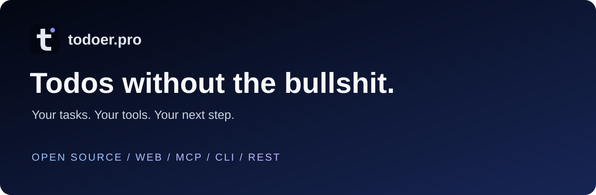

<p align="center"></p>

<p align="center">
<a href="https://app.todoer.pro"><strong>Try Todoer →</strong></a> ·
<a href="https://docs.todoer.pro">Read the docs</a> ·
<a href="deploy/README.md">Self-host</a> ·
<a href="skills/todoer.pro/SKILL.md">Connect your agent</a>
</p>
<p align="center">
<a href="LICENSE"></a>
<a href="https://github.com/mattmezza/todoer.pro/releases"></a>
<a href="https://github.com/mattmezza/todoer.pro/stargazers"></a>
</p>

# A clearer head. A smaller next step.

Todoer Pro is an open-source task manager for people who want to capture a thought,
turn a project into doable steps, and get on with their day. Use the web app yourself,
or let your AI agent work with your tasks through **MCP, CLI, or REST**.

Built in Rust with Axum, Askama and SQLite. Self-host it, inspect it, make it yours.
If that sounds like your kind of software, **[give it a star](https://github.com/mattmezza/todoer.pro)**
and share it with someone whose todos live in six different places.

| Make room for the work | How Todoer helps |
| --- | --- |
| Get it out of your head | Quick capture, Inbox, lists and sections |
| Make the next step obvious | Nested tasks, descriptions, comments and attachments |
| Plan a realistic day | Dates, recurring tasks, reminders and weekly review |
| Bring your agent along | Scoped access, searchable tasks, revision-checked writes and previews |
| Keep control | MIT source, self-hosting, exports and documented APIs |

## Free to start. Free to use with your agent.

Core task management and MCP, CLI and REST access are free. Your external agent's
own service or provider charges are separate.

**Planned:** prepaid credits for Todoer's built-in AI assistance, such as task
breakdown and classification. Account-level **bring your own key (BYOK)** is also
planned: no Todoer AI usage fee, with provider charges paid by you. Credit purchases,
a billing dashboard and account-level BYOK are not available yet. Self-hosted
operators can configure an instance-wide provider key today.

Pricing may change as the service grows. See the [public offer](https://todoer.pro/pricing.html)
and [implementation plan](docs/ai-billing-plan.md).

## Start with your AI agent

Give your agent this prompt:

> Connect to my Todoer Pro instance at https://app.todoer.pro. Read
> https://docs.todoer.pro/llms.txt and the linked agent workflow first. Help me
> authenticate with the narrowest access needed, using MCP or the Todoer CLI.
> Show my open tasks and suggest a next step. Ask before making changes.

Use your self-hosted HTTPS URL instead of `https://app.todoer.pro` when appropriate.
For a compatible remote MCP client, connect to **`https://app.todoer.pro/mcp`** and
complete browser authorization. Client support varies; the CLI is another option:

```sh
todoer --url https://app.todoer.pro login --permission read
todoer --url https://app.todoer.pro --json list
```

Download the CLI for your platform from [Releases](https://github.com/mattmezza/todoer.pro/releases)
and verify its SHA-256 sidecar. See [CLI sign-in](https://docs.todoer.pro/rebuild/cli-login.html)
and the [agent skill](skills/todoer.pro/SKILL.md) for setup, permissions and safe writes.
Agents can read the [docs index](https://docs.todoer.pro/llms.txt),
[complete docs](https://docs.todoer.pro/llms-full.txt), or individual Markdown pages.

<details>
<summary><strong>What lives in this repository?</strong></summary>

| Directory | Purpose |
| --- | --- |
| [`app/`](app/) | Current Rust app, REST API, MCP, CLI and migrations |
| [`www/`](www/) | Public website · Cloudflare Pages |
| [`docs/`](docs/) | Public docs · GitHub Pages |
| [`deploy/`](deploy/) | Docker, Compose, nginx and operations runbooks |
| [`skills/todoer.pro/`](skills/todoer.pro/) | Instructions for agents using cloud or self-hosted Todoer |
| [`extension/`](extension/) | Browser extension |
| [`legacy/`](legacy/) | Unhosted Python reference implementation |

Root Cargo files define the workspace and its shared lockfile; `app/Cargo.toml`
defines the application package. This keeps root development and release commands
consistent without duplicating dependency locks.

</details>

## Run it locally

Requires Rust 1.99+, Node.js 24, npm, a C compiler and platform build tooling
(Linux: pkg-config and OpenSSL development libraries). Python 3.11+ builds docs
and runs administrative scripts. Cargo and npm dependencies are locked.

```sh
make setup
export TODOER_DEV_AUTH=1
export TODOER_DEV_TOKEN=synthetic-local-token-at-least-24-characters
make dev
```

Open http://127.0.0.1:8092. Synthetic development mode is explicitly enabled and
loopback only; it never uses the Python database. Default data lives under
`.local/rebuild/` (retained for compatibility with existing local checkouts).
See [`app/.env.example`](app/.env.example) and
[`app/environment.example`](app/environment.example) for configuration.

```sh
make check             # formatting, Clippy, tests, debug build
make e2e               # browser tests against an already-running synthetic app
make build             # release binaries
make www-build         # stage only public website files under www/_site
python3 -m venv .local/docs-venv
.local/docs-venv/bin/pip install -r docs/requirements.txt
.local/docs-venv/bin/python docs/build.py
```

Run CLI commands with `cargo run --bin todoer -- --help`. CLI authentication,
REST and MCP setup are documented at [docs.todoer.pro](https://docs.todoer.pro).

<details>
<summary><strong>Releases and hosting setup</strong></summary>

## Releases

Releases require a clean local `main` equal to current `origin/main`, `gh` login,
and a new stable semantic version. These commands create a GitHub release;
GitHub Actions performs the builds. They do not deploy to the VPS.

```sh
make release name=v1.0.0       # publishes v1.0.0; builds ghcr.io/mattmezza/todoer.pro:v1.0.0
make cli-release name=v1.0.0   # publishes cli-v1.0.0; attaches platform executables
```

Tag pushes, normal commits and draft releases publish nothing. There is no
mutable `latest` image: deploy an explicit version or digest. App image currently
supports Linux amd64. CLI downloads cover Linux amd64/arm64, macOS Intel/Apple
Silicon and Windows amd64, each with a SHA-256 sidecar. Linux CLI binaries require
glibc (amd64 ≥2.35, arm64 ≥2.39); they are not Alpine/musl executables. Download
the matching `todoer-cli-vX.Y.Z-TARGET` asset, verify its checksum and `chmod +x`
on Unix. `.exe` is directly executable on Windows. CLI tags don't replace the
app release marked as latest in GitHub.

## Hosting setup

- **App:** shallow clone `main` on the VPS and follow [deploy/README.md](deploy/README.md).
  Run `./deploy/deploy.sh v1.0.1` (or `make deploy version=v1.0.1`) for an explicit release.
  Existing host nginx terminates HTTPS. Docker binds loopback only. Compose needs
  no `--wait` support. Initial database import is a separate, reviewed operation:
  [migration runbook](deploy/MIGRATION.md). No existing todos are migrated by CI.
- **Docs:** set repository Pages source to **GitHub Actions** and custom domain to
  `docs.todoer.pro`. Set DNS CNAME to `mattmezza.github.io` and enforce HTTPS after
  domain verification. The `docs.yml` workflow publishes only when `docs/**`
  changes on `main`; unrelated main pushes run nothing.
- **Public website:** create a **Direct Upload** Cloudflare Pages project named
  `todoer-www` (production branch `main`). Add its custom domain `todoer.pro` in
  Cloudflare and follow its DNS instructions. Disable Git auto-deploy if using an
  existing Git-connected project. Configure environment `cloudflare-pages` with
  secrets `CLOUDFLARE_API_TOKEN` (scoped to Pages editing) and
  `CLOUDFLARE_ACCOUNT_ID`; optionally set variable `CLOUDFLARE_PAGES_PROJECT`.
  Publish explicitly with `make www-publish` or `make www-deploy`, or run the
  workflow manually. Those commands dispatch `main` on GitHub, not local files.
- **Registry:** after the first app release, set GHCR package visibility to public
  separately, or authenticate VPS pulls with a read:packages token.

PR checks run on hosted runners with read-only permissions and synthetic data,
including fork PRs. The PR browser gate covers current smoke, capture/loading and
network recovery scenarios; the broader `make e2e` suite includes older scenarios
that still need selector updates. No workflow runs on ordinary main pushes except docs changes;
no workflow automatically deploys the VPS. Release jobs require a published
GitHub release and verify that its source belongs to main.

</details>

## Data and licensing

Never commit production environment files, databases, exports, backups, identity
maps or credentials. Keep verified SQLite backups, attachment storage and the
stable server key together in your recovery plan. Snapshot before every schema
upgrade. See [recovery docs](docs/rebuild/local-recovery.md).

The MIT license covers original code, docs, website and reference implementation.
Bundled third-party fonts and libraries retain their licenses and notices;
see [THIRD_PARTY_NOTICES.md](THIRD_PARTY_NOTICES.md).
